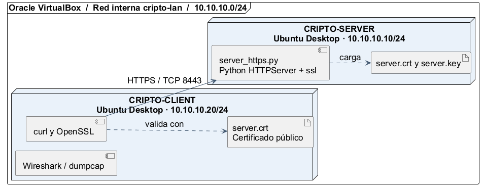

# Laboratorio de criptografía cliente-servidor

**Grupo 5 · Universidad de las Fuerzas Armadas — ESPE**
Ingeniería de Seguridad del Software · NRC 36893
Docente: Ing. Milton Leonardo Arguello Ramos

**Integrantes:** Danna Valentina Andrade Lucio, David Alexander Pilaguano Chisaguano, Erick Alejandro Tufiño Ortiz y Fernando Sandoval.

En este laboratorio probamos mecanismos de integridad, cifrado, firma digital, acuerdo de claves y verificación de contraseñas con datos ficticios. También enviamos una solicitud de matrícula por HTTPS entre dos máquinas virtuales y analizamos el tráfico con Wireshark.

## Alcance y seguridad
Práctica académica local. No utilizar claves, contraseñas ni datos reales. El servidor HTTPS es didáctico y no debe exponerse a Internet.

## Software gratuito
- Oracle VirtualBox (paquete base gratuito; no se necesita Extension Pack)
- Ubuntu Desktop en ambas VM
- OpenSSL
- Python 3 y pip/venv
- Wireshark y tcpdump
- curl
- Biblioteca Python `cryptography`
- Biblioteca Python `argon2-cffi`

## Topología
Dos VM conectadas a una red interna de VirtualBox:
- **CRIPTO-SERVER** — `10.10.10.10/24`, HTTPS en TCP `8443`.
- **CRIPTO-CLIENT** — `10.10.10.20/24`, solicitudes HTTPS y captura TLS.
Nombre de red interna: `cripto-lan`.
Usamos NAT temporalmente para instalar dependencias y lo deshabilitamos durante la captura final. Desde el cliente, comprueba la conectividad con `ping -c 4 10.10.10.10`.



## Instalación en ambas VM
```bash
sudo apt update
sudo apt install -y openssl python3 python3-venv python3-pip curl wireshark tcpdump
mkdir -p ~/lab-crypto && cd ~/lab-crypto
python3 -m venv .venv
source .venv/bin/activate
pip install cryptography argon2-cffi
```
Obtén los scripts del ZIP de recursos de la guía. Copia `crypto_lab.py` a `~/lab-crypto` en ambas VM y `server_https.py` a ese directorio en el servidor. Usa la copia de trabajo descrita en el informe técnico para las pruebas. Ejecuta A–E en el servidor. F–G requieren ambas VM.

## A. Hash SHA-256 e integridad
```bash
echo "Acta de matrícula de prueba" > acta.txt
sha256sum acta.txt | tee hash_original.sha256
python crypto_lab.py hash acta.txt
echo "Cambio no autorizado" >> acta.txt
sha256sum acta.txt
sha256sum -c hash_original.sha256
```
En T01, las huellas iniciales de Python y `sha256sum` deben coincidir. Tras editar el acta, se espera una huella distinta y `FAILED` al comprobarla contra la huella original.

## B. Cifrado simétrico AES-256-GCM
```bash
python crypto_lab.py encrypt acta.txt
ls -l acta.txt*
python crypto_lab.py decrypt acta.txt.aesgcm
cmp acta.txt acta.txt.recovered
echo $?
```
En T02, el código `0` de `cmp` confirma que los archivos coinciden. El script genera una clave AES aleatoria de 256 bits, un nonce de 96 bits y un archivo cifrado autenticado. Guardar la clave por separado y protegerla. No compartirla en el mismo canal inseguro que el archivo.

Prueba de alteración: duplicar el archivo cifrado, modificar un byte y ejecutar decrypt. En T03, el resultado esperado es `InvalidTag`.

## C. RSA: par de claves, cifrado de mensaje corto y firma
```bash
python crypto_lab.py rsa-keys
python crypto_lab.py rsa-wrap "Clave de matrícula temporal"
python crypto_lab.py rsa-unlock rsa_message.bin
```
El ejemplo demuestra RSA-OAEP con clave pública y descifrado con la clave privada. Es solo para mensajes cortos; no cifrar archivos grandes directamente con RSA.

Firma:
```bash
echo "Resolución académica de prueba" > resolucion.txt
python crypto_lab.py sign resolucion.txt
python crypto_lab.py verify resolucion.txt resolucion.txt.sig
echo "Documento alterado" >> resolucion.txt
python crypto_lab.py verify resolucion.txt resolucion.txt.sig
```
La primera verificación debe ser válida y la segunda inválida. La clave privada firma; la clave pública verifica.

## D. Acuerdo de secreto con X25519 (familia ECC / Diffie-Hellman)
```bash
python crypto_lab.py ecdh-demo
```
Se generan dos pares efímeros de demostración. Cada extremo calcula un secreto con su privada y la pública del otro. En T06, la comparación debe devolver `True`. Omite los valores completos del secreto en las evidencias. En una aplicación real, el acuerdo debe autenticarse para evitar ataques de intermediario.

## E. Hash de contraseñas con Argon2id
```bash
python crypto_lab.py password-hash
cat password.hash
python crypto_lab.py password-check "$(cat password.hash)"
```
El comando de verificación pide la contraseña. En T07, ejecuta la verificación dos veces. Se espera aceptar la contraseña correcta y rechazar la incorrecta. El hash codificado incorpora salt y parámetros. No usar SHA-256 simple para almacenar contraseñas.

## F. Comunicación HTTPS cliente-servidor
En el servidor, desde `~/lab-crypto`, crear certificado autofirmado para el laboratorio:
```bash
openssl req -x509 -newkey rsa:3072 -sha256 -days 7 -nodes \
  -keyout server.key -out server.crt \
  -subj "/CN=lab.local" \
  -addext "subjectAltName=DNS:lab.local,IP:10.10.10.10"
chmod 600 server.key
```
Copiar `server_https.py` al servidor. Iniciar:
```bash
python server_https.py
```
Copiar `server.crt` al cliente por un medio de laboratorio (por ejemplo, carpeta compartida de VirtualBox o `scp`).

En el cliente:
```bash
curl --cacert server.crt https://10.10.10.10:8443/
curl --cacert server.crt -X POST https://10.10.10.10:8443/ \
  -H "Content-Type: text/plain" --data "matricula=ESTUDIANTE-DE-PRUEBA"
```
No usar `-k` como solución normal: omite la validación del certificado. En este laboratorio se confía explícitamente en el certificado autofirmado copiado.

Inspección TLS:
```bash
openssl s_client -connect 10.10.10.10:8443 -CAfile server.crt -verify_ip 10.10.10.10 -verify_return_error -tls1_3
```
En T08 se esperan respuestas JSON a GET y POST, y `Verification: OK` en OpenSSL. En la ejecución del grupo se registró TLS 1.3 con `TLS_AES_256_GCM_SHA384`.

## G. Captura con Wireshark
1. En la VM cliente, abrir Wireshark y seleccionar la interfaz de la red interna.
2. Usa `tcp port 8443` como filtro de captura o `tcp.port == 8443` como filtro de visualización.
3. Ejecutar los comandos curl desde otra terminal.
4. Identifica ClientHello, ServerHello y Application Data. En TLS 1.3, el certificado se transmite cifrado después de ServerHello.
5. Guarda el archivo `.pcapng` y anota los números de paquete de cada tipo de mensaje.
6. En T09 se espera identificar los mensajes TLS sin poder leer el cuerpo del POST en texto claro.

## Documentos y diagramas

| Archivo | Contenido |
| --- | --- |
| [01 · Documento de diseño](Documentos/01_Documento_de_Dise%C3%B1o.pdf) | Objetivos, requisitos, arquitectura y flujo de datos. |
| [02 · Informe de análisis técnico](Documentos/02_Informe_de_Analisis_Tecnico.pdf) | Resultados, preguntas de la guía, incidencias y conclusiones. |
| [03 · Diagramas del laboratorio](Documentos/03_Diagramas_del_Laboratorio.pdf) | Topología, flujos criptográficos, secuencia HTTPS y captura TLS. |
| [04 · Matriz de pruebas y evidencias](Documentos/04_Matriz_Pruebas_y_Evidencias.pdf) | Criterios de aceptación y resultados de T01 a T09. |

En [Diagramas/](Diagramas/) están los nueve diagramas en PlantUML (`.puml`) y sus imágenes (`.png`). El [flujo general](Diagramas/flujo_criptografico.puml) ubica las pruebas locales. La [secuencia HTTPS](Diagramas/secuencia_https.puml) y el [flujo de captura](Diagramas/captura_tls_t09.puml) describen las pruebas entre las VM.

## Pruebas y evidencias

El [resumen de ejecución](Evidencias_T01_T09/logs/resumen_final.docx) reporta **PASS en T01–T09**. En las pruebas negativas, el PASS corresponde al rechazo esperado.

| Prueba | Criterio comprobado | Evidencia |
| --- | --- | --- |
| T01 · SHA-256 | La huella cambia al modificar el acta. | [Comparación de hashes](Evidencias_T01_T09/evidencias/T01/resultado.docx) |
| T02 · AES-256-GCM | El archivo recuperado coincide byte a byte con el original. | [Descifrado y comparación](Evidencias_T01_T09/evidencias/T02/descifrado.docx) |
| T03 · AES-256-GCM alterado | El descifrado rechaza la copia alterada con `InvalidTag`. | [Prueba negativa](Evidencias_T01_T09/evidencias/T03/alteracion_aes.docx) |
| T04 · RSA-PSS y RSA-OAEP | La firma original se valida y OAEP recupera el mensaje corto. | [Firma](Evidencias_T01_T09/evidencias/T04/firma.docx) · [OAEP](Evidencias_T01_T09/evidencias/T04/rsa_oaep.docx) |
| T05 · Firma RSA | La verificación rechaza el documento modificado. | [Firma inválida](Evidencias_T01_T09/evidencias/T05/firma_alterada.docx) |
| T06 · X25519 | Ambos participantes calculan el mismo secreto. | [Comparación](Evidencias_T01_T09/evidencias/T06/ecdh_sanitizado.docx) |
| T07 · Argon2id | Se acepta la contraseña correcta y se rechaza la incorrecta. | [Correcta](Evidencias_T01_T09/evidencias/T07/verificacion_correcta.docx) · [Incorrecta](Evidencias_T01_T09/evidencias/T07/verificacion_incorrecta.docx) |
| T08 · HTTPS | El certificado se valida y el servidor responde a GET y POST. | [OpenSSL](Evidencias_T01_T09/evidencias/T08/openssl_s_client.docx) · [GET](Evidencias_T01_T09/evidencias/T08/respuesta_get.json) · [POST](Evidencias_T01_T09/evidencias/T08/respuesta_post.json) |
| T09 · Captura TLS | Se identifican los saludos TLS y registros cifrados. | [Captura PCAPNG](Evidencias_T01_T09/evidencias/T09/captura_tls.pcapng) · [Análisis de Application Data](Evidencias_T01_T09/evidencias/T09/application_data.docx) |

Los registros de ejecución se encuentran en [Evidencias_T01_T09/logs/](Evidencias_T01_T09/logs/). Para revisar T09, abre la captura en Wireshark y aplica el filtro de visualización `tcp.port == 8443`. La negociación registrada usó TLS 1.3 con `TLS_AES_256_GCM_SHA384`.

## Alcance de los resultados
- El certificado autofirmado no equivale a una identidad validada por una CA pública.
- La práctica demuestra TLS y primitivas, no implementa un protocolo de mensajería seguro completo.
- No inventar algoritmos criptográficos propios.
- Nunca subir claves privadas ni contraseñas al repositorio.
- El modo `-k` de curl desactiva la validación del certificado; no usarlo en producción.
